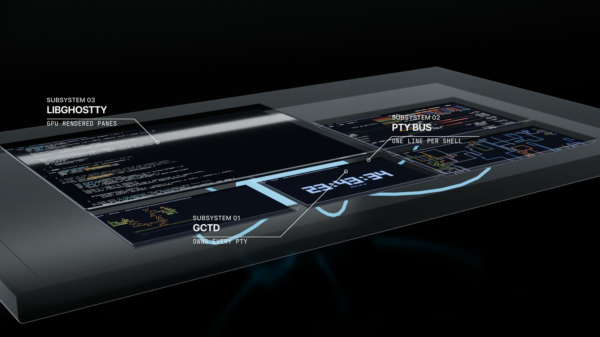
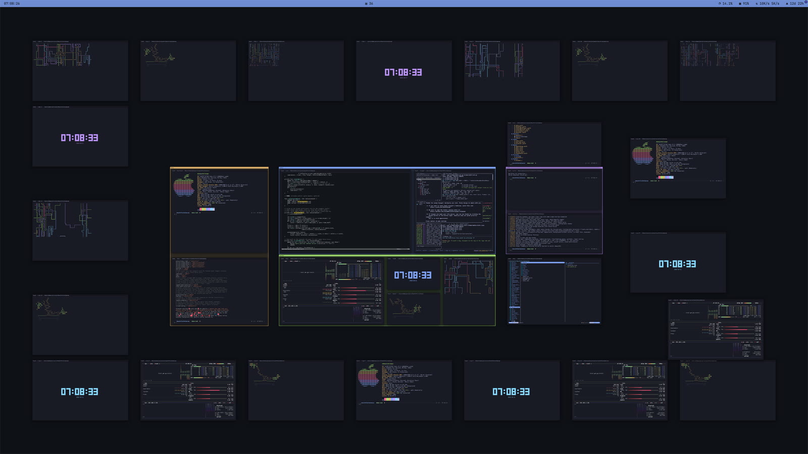
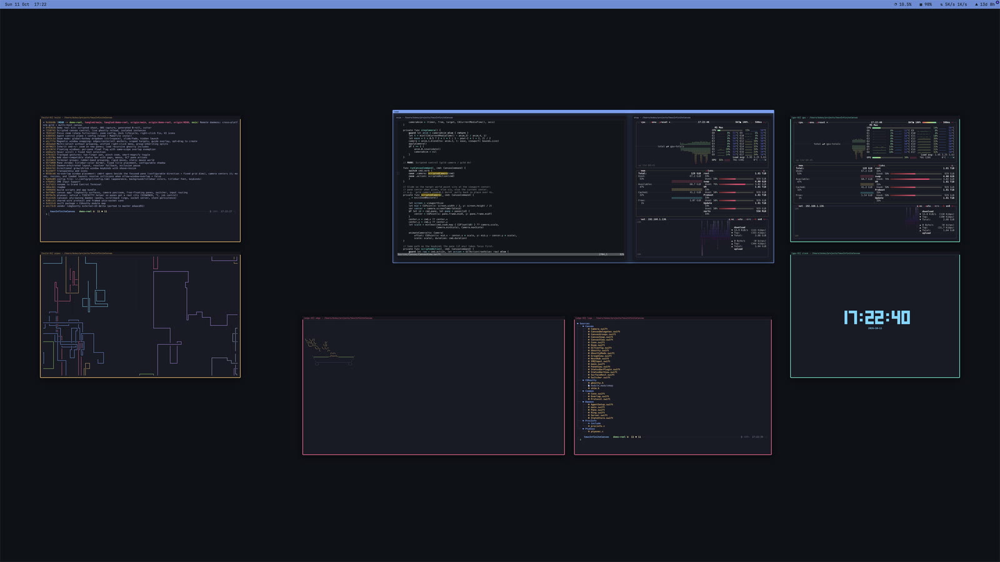

# Grand Central Terminal

A terminal multiplexer that behaves like tmux but lives on an **infinite
canvas**: no splits, no tabs — panes are free-floating windows you place,
move, resize, and zoom around, exactly like a figma/miro board of terminals.

Built on **libghostty** (Ghostty's core) for terminal emulation + GPU
rendering, with a tmux-style **client/daemon split**: a headless daemon owns
every PTY, so closing the app detaches and the shells keep running; relaunch
and everything reattaches, scrollback replayed.

<p align="center">
  <a href="docs/media/gct-reel.mp4"></a>
</p>
<p align="center"><a href="docs/media/gct-reel.mp4"><b>▶ Watch the reel</b></a> · 72s, 1080p60</p>

## Download

Grab the latest release from
[forgejo](https://git.dubey.io/dubey/grandcentralterminal/releases):

- **macOS (arm64)**: `GrandCentralTerminal-<ver>-macos-arm64.zip` —
  unzip, drag `Grand Central Terminal.app` to `/Applications`, open.
  Signed with a Developer ID + notarized, so Gatekeeper passes with
  no warnings.
- **Linux (x86_64/arm64)**: `gctd-<ver>-linux-<arch>.tar.gz` — the
  headless daemon + `ptyexec`, fully static (runs on any distro):

```sh
tar -xzf gctd-<ver>-linux-<arch>.tar.gz -C ~/.local/bin
gctd --port=7420 --token=<token>   # point the mac canvas at it via [host.<name>]
```



## What's implemented

- Infinite canvas: drag empty space to pan; scroll over a terminal scrolls
  the terminal (wheel or trackpad, no modifier — `scroll-on-terminal-hover`,
  default true), scroll over empty canvas pans (two-finger trackpad) or
  zooms toward the cursor (mouse wheel); pinch also zooms
  (`zoom-min`–`zoom-max`, default 0.03–4.0×; above 1.0 the
  texture magnifies — use per-pane `cmd-+/-` for sharp big text);
  two-finger double-tap toggles actual size vs fit-all; `⌘0` fits all
  panes; `⌘Z` focus-zooms the pane into a sharp local fullscreen (the
  surface reflows + re-renders vector-crisp, never a raster upscale; `⤢`
  marker + accent chrome while zoomed). Toggle restores frame + camera;
  focus moves, `⌘0`, titlebar/resize grabs, and double-tap exit; pan /
  wheel / pinch hold while zoomed; fits dodge the status bar.
  - drag the titlebar to move, edges/corners to resize (live PTY reflow);
  the whole titlebar band grabs for moving — only the corners and the
  side/bottom edges resize — and right-clicking any window chrome
  (titlebar or border) offers add-to/remove-from named groups
  - click to focus (`focus-follows-mouse = true` focuses on hover instead);
    click-drag inside a terminal selects text; `⌘H/J/K/L` moves focus to the
    nearest pane in that direction (camera centers + zooms to fit it — both
    configurable); `⌘P` opens a type-to-filter switcher and jumps the
    camera the same way
  - `⌘T` new pane (opens beside the focused pane — direction and size are
    configurable — and focuses + centers it; inherits the focused pane's
    cwd and `cmd-+/-` zoom; a directional split from a grouped pane joins
    that group — loose panes in the way are shoved aside along the split
    axis, cascading, while foreign groups still refuse the join), `⌘W`
    close, `⌘R` rename (the `✻`-style named panes in the titlebar; on a
    grouped pane it renames the GROUP instead).
    `⌘⇧H/J/K/L` opens a new pane on that fixed side with the
    same size/focus/camera rules (joins the focused pane's group too)
    Mouse drags never shove anything aside — they slide along collisions
    and hold when wedged (only keyboard grow shoves;
    `allow-mouse-drag-to-push = true` opts mouse drags back into shoving).
    Multi-select (no grouping until asked): right-drag empty space stages
    a selection, `⇧`-click a titlebar toggles one pane, `⌘D` toggles the
    focused pane, `⌘⇧D` clears; drag a selected titlebar to move the block
    (rigid, slides along collisions), `⌘W` closes every selected pane,
    `⌘G` groups the selection. Right-click anywhere off-pane always pops
    one menu: selection actions when live, group actions on a group
    background, plus "New pane here".
    Floating windows (`⌘F`, `toggle-floating`): a floated pane ignores the
    overlap rule within its own scope — a grouped pane floats over its
    siblings, an ungrouped one over every other ungrouped pane — and
    always stacks above tiled panes with a `⬆` title marker + deeper
    shadow. Foreign group bounds still block floaters, tiled panes slide
    under floaters instead of shoving them, and re-pressing `⌘F` re-tiles
    the pane back into the layout. With `allow-window-overlap = true`
    every window already overlaps, so floating only changes the stacking
    + marker.
  - `⌘C` copies the selection (or sends `^C` when nothing is selected),
    `⌘V` pastes
  - dead keys, accents, and IME composition work: keys route through the
    text input system, preedit renders inline at the cursor, commit lands
    as typed input, and composition keys (⌫, ^H) only affect the preedit
- Panes carry a titlebar-color border on the left/right/bottom edges
  (`[titlebar] border-width`, default 4pt — wider stays grabbable for
  edge/corner resizes even zoomed out) and a configurable drop shadow
  (`shadow-opacity` 0 turns it off, `shadow-radius` blurs). Programs
  speaking [OSC 7501 program status](https://www.superlogical.com/rex/docs/build/program-status)
  show their state right-aligned in the titlebar (`◌ 40%` working,
  `▲` blocked, `✓` done, `✕` error, plus the program's message) —
  per pane, local and remote, cleared when you type into the pane.
- Status bar (`[statusbar]`, off by default): top/bottom overlay of
  xbar-compatible plugin components — any executable in
  `~/.config/gct/statusbar/` named `{name}.{interval}.{ext}`
  (e.g. `clock.10s.sh`), picked up live with no recompile/restart.
  `gap` spacers absorb leftover width, so
  component-gap-component-gap-component aligns left/center/right.
  Click a component for its dropdown menu (`---` section, `--` submenus);
  rows with `href=` open URLs, `shell=` runs detached, `terminal=true`
  opens in a new GCT pane, `refresh=true` re-runs the plugin. Headers
  before the first `---` cycle in the bar; `image=`/`templateImage=`
  take base64 icons. Own background/text color, font, and opacity;
  always above panes on its own layer, outside the camera transform.
- Daemon (`gctd`) persists pane layout + groups to
  `~/Library/Application Support/Grand Central Terminal/state.json`; on daemon
  restart it respawns shells in their recorded cwd/rects and restores groups
  (members pruned to live panes). Scrollback lives
  with the daemon (8 MiB ring per pane) and is replayed on attach.
  `⌘Q` quits the canvas UI (panes keep running in gctd; relaunch
  reattaches); the Dock menu's "Quit Daemon" kills every terminal.
  A Dock click re-summons a doom-hidden window.

## Layout

```
vendor/ghostty/          ghostty @ a4aacd91 + patches/libghostty-external-io.patch
patches/                 the external-IO delta (see patches/README.md)
Sources/Common/          wire protocol + framed socket connection (unix + TCP)
Sources/Daemon/          gctd: PTYs, panes, scrollback, persistence
Sources/PtyExec/         setsid + TIOCSCTTY + exec helper (per-pane child)
Sources/Canvas/          the AppKit app: camera, panes, switcher, input
Sources/Canvas/HostHub.swift  one conn per daemon, owner routing + id mapping
Makefile                 build/sign/install/uninstall/clean
scripts/fetch-ghostty.sh clones + patches the vendored ghostty
scripts/build-remote.sh  build + deploy the Linux daemon over ssh
scripts/release-macos.sh CI-signed macOS zip (notarized + stapled)
scripts/release-linux.sh CI static-stdlib Linux gctd tarball
.forgejo/workflows/release.yml  tag v* -> signed macOS + Linux artifacts
demo/                    scripted shoot + reel kit (see demo/README.md)
docs/media/              README stills + the reel
```
## Build

```sh
scripts/fetch-ghostty.sh  # once: clone ghostty at the pinned commit + patch
make build                # libghostty (zig 0.16, incremental) + app bundle
make install              # sign (Developer ID) + /Applications +
                          # /usr/local/bin/gctd + harness skill install
make uninstall clean      # remove /Applications copy; drop artifacts
```

## Release

Tag `v*` on main; Forgejo CI builds both packages and attaches them
to the tag's release page:

```sh
git tag v0.3.0 && git push origin v0.3.0
```

* `GrandCentralTerminal-<ver>-macos-arm64.zip` — the `.app` signed
  with the Developer ID (hardened runtime), notarized, ticket
  stapled: Gatekeeper passes offline on a fresh Mac.
* `gctd-<ver>-linux-<arch>.tar.gz` — `gctd` + `ptyexec` with a
  static Swift stdlib (only stock libc stays dynamic): unpacks and
  runs on most distros, no toolchain needed.

CI secrets (`/{owner}/{repo}/settings/actions/secrets`):
`APPLE_CERT_P12_B64` (base64 Developer ID `.p12`),
`APPLE_CERT_PASSWORD`, `KEYCHAIN_PASSWORD`, `APPLE_ID`,
`APPLE_TEAM_ID`, `NOTARY_PASSWORD` (app-specific password).
Runner labels in `.forgejo/workflows/release.yml` are `macos` and
`linux` — rename to match your runners if they differ.

Prereqs: Xcode (macOS SDK), [zig 0.16.0](https://ziglang.org/download/) on
`PATH` (or `ZIG=/path/to/zig`), Metal Toolchain
(`xcodebuild -downloadComponent MetalToolchain`, one-time).
`SIGN_IDENTITY=` overrides the Developer ID signer.

`make build` stages the daemon at
`~/Library/Application Support/Grand Central Terminal/bin/gctd`; the app
auto-starts it if it isn't running.

## Daemon

```sh
gctd status     # list panes
gctd stop       # kill daemon + panes
```

## Remote daemons

`gctd` runs on macOS (unix socket, `.app`-bundled) and Linux (unix socket
+ optional TCP). The mac canvas talks to any number of remote daemons over
TCP: each host's windows get their own color, and right-clicking empty
canvas offers "New remote pane" per host.



```sh
# 1. Build + deploy the Linux daemon (Swift builds in a container
#    on the remote; no local toolchain needed beyond ssh + podman there).
#    Installs a systemd user service (linger on, restart on failure).
scripts/build-remote.sh dubey@192.168.1.38 7420 <token>
scripts/install-remote.sh dubey@192.168.1.38 7420 <token>

# Or by hand on the remote:
LD_LIBRARY_PATH=$HOME/gct-remote/lib $HOME/gct-remote/bin/gctd \
  --port=7420 --token=<token>
```

```toml
# ~/.config/gct/config.toml — direct LAN (same subnet, no tunnel).
[host.enterprise]
host = "192.168.1.38"
port = 7420
token = "<token>"
color = "#f59e0b"   # optional; default = auto from the palette
```

Reload config (`⌘⇧R`): the canvas connects, and the host's panes join the
canvas with its color. Trouble connecting? `ssh` tunnel fallback (token
never leaves localhost):

```sh
ssh -L 7420:127.0.0.1:7420 -N -f dubey@192.168.1.38
```

```toml
[host.enterprise]
host = "127.0.0.1"
port = 7420
token = "<token>"
```

Remote panes behave like local ones (PTYs live on the remote; scrollback,
resize, groups, and persistence all work), with three rules: groups are
same-host only (mixed selections group the largest same-host subset),
`⌘T`/directional splits follow the focused pane's host, and each daemon
arbitrates its own layout (the canvas pre-resolves against the union
world, so cross-host windows never overlap). `⌘⇧R` reconnects when
`[host.*]` changes; a dropped host clears its panes (retry via reload).
The CLI targets remotes too: `gctd --tcp=192.168.1.38:7420 --token=<token>
list` (env: `GCT_TCP`, `GCT_TOKEN`). Serve flags: `gctd --port=N
--token=..` (env: `GCT_PORT`, `GCT_TOKEN`); paths honor `$HOME` first,
`GCT_HOME` overrides the base dir (Linux default `~/.config/gct`).

## Agents (harness control surface)
`gctd` doubles as the agent/harness CLI against the running daemon —
prefer GCT panes for background tasks (grouped, no time limits,
user-inspectable on the canvas). Full prompt in `SKILL.md`.

```sh
gctd open name=build cmd="make -j8"  # pane beside the working one, prints id
gctd list                            # panes + groups
gctd dump $ID limit=4000 --strip-ansi # scrollback tail as readable text
gctd send $ID "make test"            # type into the pane (+ newline)
gctd rename $ID name=server
gctd group $A $B name=feat color=#3b82f6
gctd focus $ID                       # focus + center on the canvas
gctd camera $ID zoom=0.4 dur=3       # glide to a pane (or x= y=) at a zoom
gctd do fit-all [$ID] [dur=4]       # run any keybind action, focusing $ID first
gctd close $ID
```

Panes are addressed by uuid prefix, exact name, or `self` (the calling
pane's `$GCT_PANE_ID`). `dump` reads the daemon's 8 MiB VT ring read-only
— poll it to follow a task; `--strip-ansi` scrubs escapes for reading.
`cmd=` runs through the login shell (real syntax: `&&`, pipes, quotes);
the pane exits when the command does (`; exec zsh` keeps it open).
Group correlated windows (`group $A $B name=feat`), tail subagents in
small grouped panes, and close task panes when the work lands.

### How an agent finds out: `agent-setup`

```sh
gctd agent-setup install --hooks --yes   # skill into every harness dir + Claude hook
gctd agent-setup print                  # targets + skill text (manual installs)
gctd agent-setup context                # live pane state (what the hook emits)
```

`install` copies `SKILL.md` (staged beside the daemon by `make build`, no
network) into the Claude, Codex, opencode, Cursor, and Cursor-agents skill
dirs (`--harness=` narrows it; dry-run without `--yes`). `--hooks` merges
a Claude `SessionStart` hook (via `/usr/local/bin/gctd`, no spaces) that
injects live pane state every session — that's the discovery path: the
agent learns GCT exists plus what's currently on the canvas, before the
first prompt. The hook carries a 15s timeout and `|| exit 0`: daemon down,
wedged, or unexecable binary = empty context, never an error, never blocks
start. Re-running `install --hooks` migrates stale entries in place.
Codex also needs `[features] skills=true` in its config.

Each pane's shell runs via `ptyexec`, which takes a fresh session, claims
the slave pty as its controlling terminal, and execs the shell — without
the ctty, `TIOCSWINSZ` never delivers `SIGWINCH` and tty signals (^C, ^Z,
job control) don't work. The pane environment pins `TERM=xterm-256color`,
`COLORTERM=truecolor`, and `LANG=en_US.UTF-8` (GUI-launched daemons inherit
launchd's sparse env, which degrades htop et al. to monochrome), and strips
`NO_COLOR` (tool harnesses set it; panes are new terminals and should color).

## Doom mode

Quake-style dropdown: a system-wide hotkey (Carbon, no Accessibility
permission) summons the fullscreen canvas with a slide-down or fade
animation; the same hotkey hides it and restores the previous app. The
PTYs keep running while hidden — only the window hides. Hotkey only:
panning the canvas never dismisses it.

```toml
[doom]
enabled = true
toggle = "ctrl+space"   # global; named keys work (space, f1-f12...)
animation = "fade"       # fade | slide
animation-duration = 0.2
screen = "mouse"        # mouse | main | menubar
start-hidden = true     # launch ordered-out; hotkey summons
launch-at-login = false # login item (also in system Settings)
```

Notes: the combo is eaten system-wide while GCT runs (shells never see
it); stock macOS binds `ctrl+space` to input-source switching, so free
it in Settings or pick another bind. The summon lifts the window above
fullscreen apps (same recipe as Ghostty's quick terminal) — `ctrl+space`
works from inside a fullscreen app. Hotkey registration failure is
loud (log + stay visible) — a silent failure would strand a hidden
window with the Dock as the only way back. Validation: hidden launch,
`ctrl+space` round-trip (frontmost flips GCT → previous app), typing
in a summoned pane (`⌘T`, `echo`), both animations.

## How the external backend works

Upstream libghostty surfaces always spawn their own PTY. This project needs
the daemon to own the PTYs, so we carry a small delta (ported from
`daiimus/ghostty:ios-external-backend` onto upstream master) that adds a
`GHOSTTY_BACKEND_EXTERNAL` termio backend: the app feeds raw VT bytes in via
`ghostty_surface_write_output` (serialized on a per-surface queue) and
receives keystrokes through the surface's `write_callback`; grid resizes
arrive via `resize_callback` and go to the daemon as `TIOCSWINSZ`. See
`patches/README.md`.

## Known limits (v0.1)

- The daemon's scrollback ring is memory-only: `gctd stop` loses history
  (same as killing a tmux server).
- Panes render live at every zoom level; many heavy panes will cost GPU.
- Doom-hidden windows pause every pane renderer (ordered-out presents
  nothing); VT keeps flowing and replays on show.
- macOS quirk: `read()` on a pty master never returns when the shell dies
  (unlike Linux's EIO), so dead panes are detected by the daemon's reaper
  and can linger briefly as a frozen frame before cleanup.

| Key | Action |
| --- | --- |
| `⌘T` | new pane |
| `⌘W` | close focused pane (or every selected pane when focused is selected) |
| `⌘R` | rename focused pane (or its group) |
| `⌘Z` | focus-zoom pane to a sharp local fullscreen (toggle restores frame + camera) |
| `⌘G` | group staged selection (else rename focused pane's group) |
| `⌘D` | toggle focused pane in multi-select |
| `⌘⇧D` | clear multi-select |
| `⌘F` | float / re-tile focused pane |
| `⌘⇧S` | toggle window snapping (session-only, never moves panes) |
| `⌘⇧R` | reload config.toml (live: theme, keybinds, snapping, doom hotkey) |
| `⌘⌃H/J/K/L` | grow focused pane toward left/down/up/right (shoves blockers) |
| `⌘⌃⇧H/J/K/L` | shrink focused pane from that edge |
| `⌘P` | pane switcher (type to filter, ⏎ to jump) |
| `⌘0` | fit all panes |
| scroll over terminal | scroll the terminal (wheel or trackpad) |
| trackpad scroll over empty canvas | pan canvas |
| wheel scroll over empty canvas | zoom canvas (toward cursor) |
| click-drag inside terminal | select text (`⌘C` copies) |
| pinch | zoom canvas (toward cursor) |
| two-finger double-tap | toggle actual size / fit all |
| drag empty space | pan |
| opt-drag empty space | draw a new pane (free corner snaps, live cols×rows pill) |
| right-drag empty space | rubber-band panes into a staged multi-select (no grouping yet) |
| right-click canvas/group background | one menu, always: selection actions (when live) + group actions (on background) + new pane here + Arrange By / As + snapping on/off |
| Arrange menu (menubar) | one-shot tidy of the selection, else the focused group, else everything: sort by clean-up / name / directory / status / last focused / activity, as rows / columns / grid; Undo Arrange reverts |
| right-click window chrome | add to / remove from named group, new group |
| shift+click titlebar | toggle pane in multi-select |
| drag selected titlebar | move the whole selection as a rigid block |
| drag titlebar | move pane (titlebar band always moves; corners + side/bottom edges resize; edges/center snap within the radius, guides light) |
| drag group background | move every member together |
| drag edges/corners | resize pane (moving edges snap, guides light) |
`~/.config/gct/config.toml` — created with defaults on first launch; every key
is optional and malformed values fall back to their defaults. `⌘⇧R`
(reload-config) re-reads it live — theme, keybinds, snapping/overlap
policy, status bar, doom hotkey; only doom's structural keys (enabled,
start-hidden, launch-at-login) need a relaunch. Root-level keys (like
`appearance` and the placement keys below) must appear before the first
`[table]` header — after one, they belong to that table.

```toml
# Light/dark mode: "light", "dark", or "system" (follow macOS).
appearance = "system"

# Window placement. Panes are kept from overlapping unless you allow it:
# new panes, moves, and resizes all resolve collisions.
allow-window-overlap = false
# Forced padding between windows in world points (0-256, default 0 =
# flush): every collision resolve keeps at least this much air. Raising
# it re-spreads existing panes on reload-config (and next launch);
# lowering it only affects future moves.
window-gap = 0
# Magnetic window snapping (on, edges): drags/resizes within
# snap-radius pull flush with nearby panes + light full-canvas guides
# (fast fade in/out). snapping-type picks the anchors: edges (min/max,
# default), center (mid), or all. Scope: grouped panes (even solo) snap
# only to siblings in the same group — never outside; whole-group drags
# snap the group border to ungrouped panes and foreign group borders;
# ungrouped panes snap to ungrouped panes and group borders (never into
# grouped members).
snapping = true
snapping-type = "edges"  # edges | center | all
# Snap radius in screen points (constant feel at any zoom).
snap-radius = 16
# Guide lines: false hides them; snap-guide-color tints them (hex like
# "#ff453a", "default" for translucent silver, "none" to hide — the
# snap still applies).
show-snap-guides = true
snap-guide-color = "default"
# Mouse drags never shove anything aside (they slide or hold); keyboard
# grow always shoves. Set true to let mouse drags shove too.
allow-mouse-drag-to-push = false
new-window-open-direction = "right"  # above | below | left | right
# New pane size: "follows" copies the focused pane, or fix a terminal grid
# as "cols,rows" (e.g. "80,30"). With no panes on the canvas, a standard
# 80x24 terminal opens. Directional open-new-window-* uses this same size.
new-window-dim = "follows"
# Keyboard resize step (grow-window-*/shrink-window-*): one terminal cell
# per press when measurable, else resize-step-points. resize-step-cells
# scales the cell step (e.g. 2 = two cells per press).
resize-step-cells = 1
resize-step-points = 40
# Animate the camera to center a pane created with cmd+t or an
# open-new-window-* bind (when its focus move fires).
move-focus-on-new-window = true
# Directional focus moves (cmd+h/j/k/l): center the newly focused pane,
# and/or zoom to fit it. Independent; both default true (fit implies
# centered, so both true just zooms to fit).
camera-follows-focus-move = true
camera-fits-focus-move = true
# Focus the pane under the cursor on mouse motion (same name as ghostty's
# focus-follows-mouse). Off by default: click to focus.
focus-follows-mouse = false
# Scroll (wheel or trackpad) over a terminal scrolls the terminal; scroll
# over empty canvas zooms at the cursor. Set false for the old behavior:
# trackpad pans, shift+scroll goes to the terminal, wheel zooms.
scroll-on-terminal-hover = true
# Canvas zoom limits for wheel/pinch (world scale, 1.0 = actual size):
# zoom-min 0.005-1, zoom-max 1-8 (live via reload-config). Above 1.0 the
# terminal texture magnifies (slightly soft); per-pane cmd-+/- stays sharp.
zoom-min = 0.03
zoom-max = 4
# Camera glide in seconds (focus moves, fit-all, switcher jumps),
# 0.05-10. Slow it down for screen recordings.
camera-animation-duration = 0.28

# Canvas background per mode. Hex like "#1a1b26" (alpha 1), or with alpha
# like "#1a1b2680" / "#1234" — alpha < 1 makes the canvas transparent,
# showing the desktop behind it. "ghostty" reuses the background color
# from your ghostty config. Transparent canvas is look-but-don't-touch:
# empty space stops receiving mouse events (no pan, no opt-drag), while
# panes (opaque views on top) keep working.
dark = "#000000"
light = "#ffffff"

 [titlebar]
 # Pane titlebar colors. RGBA hex like "#2b2b2b" or "#2b2b2bcc", or
 # "default" for the usual grey. The left/right/bottom border uses the
 # same color as the titlebar background.
 background = "default"
 text = "default"
 # Title text font: family name (e.g. "SF Mono") and size in points.
 font = "default"
 font-size = 12
 # Border on the left/right/bottom edges in points (the top edge is the
 # titlebar itself). Wider borders grab edges/corners for resizing more
 # easily, even zoomed out.
 border-width = 4
 # Drop shadow: opacity 0 turns it off, radius blurs it. Defaults match
 # the current look.
 shadow-opacity = 0.55
 shadow-radius = 12

    [statusbar]
    # Overlay bar of xbar-compatible executables in
    # ~/.config/gct/statusbar/ ({name}.{interval}.{ext}, e.g.
    # clock.10s.sh — picked up live, no recompile/restart). Flip
    # `enabled` (or any key here) then reload-config.
    enabled = false
    # Bar edge: "top" or "bottom". Always above panes on its own layer.
    position = "bottom"
    # Ordered cells: plugin basenames plus `gap` spacers absorbing
    # leftover width (component-gap-component-gap-component =
    # left/center/right).
    components = "clock, gap"
    height = 26
    spacing = 8
    background = "default"
    text = "default"
    font = "default"
    font-size = 12
    # Overall opacity 0-1.
    opacity = 1

[keybinds]
# App shortcuts. Modifiers cmd, ctrl, alt, shift joined with "+"; the last
# part is the key, e.g. new-pane = "cmd+shift+t".
new-pane = "cmd+t"
close-pane = "cmd+w"
rename-pane = "cmd+r"
move-focus-above = "cmd+k"
move-focus-below = "cmd+j"
move-focus-left = "cmd+h"
move-focus-right = "cmd+l"
# Directional new panes. Side is fixed by the action; size follows
# new-window-dim; focus/camera follow move-focus-on-new-window and the
# camera-follows/fits-focus-move flags.
open-new-window-above = "cmd+shift+k"
open-new-window-below = "cmd+shift+j"
open-new-window-left = "cmd+shift+h"
open-new-window-right = "cmd+shift+l"
# Directional resize: grow moves that edge outward (shoving blockers when
# overlap is disallowed), shrink pulls it back. Opposite edge stays put.
grow-window-above = "cmd+ctrl+k"
grow-window-below = "cmd+ctrl+j"
grow-window-left = "cmd+ctrl+h"
grow-window-right = "cmd+ctrl+l"
shrink-window-above = "cmd+ctrl+shift+k"
shrink-window-below = "cmd+ctrl+shift+j"
shrink-window-left = "cmd+ctrl+shift+h"
shrink-window-right = "cmd+ctrl+shift+l"
switcher = "cmd+p"
fit-all = "cmd+0"
# tmux-style: fill the viewport with the focused pane (toggle restores
# the exact camera; focus moves exit).
zoom-pane = "cmd+z"
copy = "cmd+c"
paste = "cmd+v"
# Multi-select (staged, NOT a group): right-drag selects, shift+click a
# titlebar toggles, toggle-pane-selection flips the focused pane;
# drag a selected titlebar moves the block; close-pane closes the block
# when focused is selected; group-selection groups it; right-click with
# a live selection offers group / close / clear.
toggle-pane-selection = "cmd+d"
clear-pane-selection = "cmd+shift+d"
# Groups: group-selection (cmd+g) on a 2+ staged selection makes one
# (colored background, blocks non-members even when overlap is allowed);
# otherwise it renames the focused pane's group. Drag the background to
# move it; right-click it for rename/color/ungroup; rename-pane (cmd+r)
# targets the group when the focused pane has one. A group with no
# members left is deleted (closing or removing its last pane); it won't
# linger in the add-to menu.
group-selection = "cmd+g"
ungroup = "cmd+shift+g"
# Snapping: flip magnetic window snapping at runtime (session-only;
# never moves already-placed panes).
toggle-snapping = "cmd+shift+s"
# Config: re-read config.toml and apply live (theme, keybinds,
# snapping/overlap policy, doom hotkey). Doom structural keys
# (enabled, start-hidden, launch-at-login) need a relaunch.
reload-config = "cmd+shift+r"

Terminal settings (inside panes) are ghostty's domain and come from your
ghostty config as usual (`~/.config/ghostty/config`, App Support override,
`config-file` includes included); GCT's built-in defaults only fill keys
your config leaves unset. `cmd-+/-` zoom is per-pane and carries to new
panes (off via ghostty's `window-inherit-font-size = false`).
The `background.dark`/`light` value `"ghostty"` makes the canvas follow
whatever background your ghostty config resolves to.
