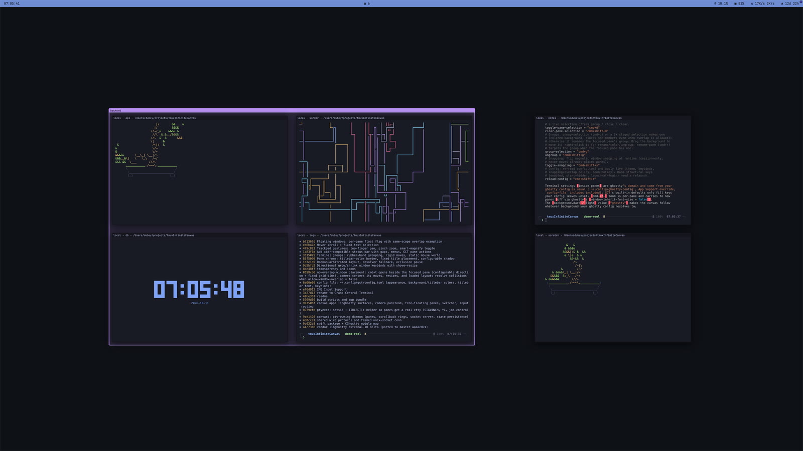

<h1 align="center">Grand Central Terminal</h1>
<p align="center">
  A terminal multiplexer that doesn't hide your terminals.
  <br />
  One infinite canvas, and agents are welcome on it.
  <br />
  <a href="#what-is-this">About</a>
  ·
  <a href="#install">Install</a>
  ·
  <a href="docs/usage.md">Usage</a>
  ·
  <a href="docs/configuration.md">Configuration</a>
  ·
  <a href="docs/keybindings.md">Keybindings</a>
  ·
  <a href="docs/agents.md">Agents</a>
</p>

<p align="center">
  
</p>

## What is this?

GCT is a terminal multiplexer, like tmux. A daemon owns your shells and the
app attaches to it, so quitting the app kills nothing. Relaunch and your
panes are back with their scrollback.

The difference is that nothing is hidden. tmux has sessions, windows and
panes, plus a status line to tell you what's in the ones you can't see. GCT
has windows. All of them are live on one infinite canvas, and you pan and zoom
to look at whichever you like. You can group windows, but a group is a colored
box you drag around. It isn't a level in a hierarchy you have to navigate.



It's built on [libghostty](https://github.com/ghostty-org/ghostty), so
terminals render on the GPU and read your Ghostty config. macOS app, with
daemons for macOS and Linux.

## What about agents?

GCT was built for them. Coding agents run builds, dev servers and test loops
in the background all day, and you find out one is stuck when the agent tells
you, or doesn't. In GCT the agent opens a pane, the pane shows up on your
canvas, and you can see what the job is doing without asking.

```sh
gctd open name=build cmd="make -j8"      # a new pane on your canvas
gctd dump build --strip-ansi             # the agent reads it back
```


`gctd agent-setup install` teaches Claude, Codex, opencode and Cursor that
this exists. See [docs/agents.md](docs/agents.md).

## Why that name?

It's a central terminal for your terminals, and it's grand. The daemon is
`gctd`: grand central terminal depot.

## Install

Grab a build from the
[releases page](https://github.com/DWS-LLC/grandcentralterminal/releases).

macOS (arm64): `brew install --cask dws-llc/tap/gct`, or unzip
`GrandCentralTerminal-<ver>-macos-arm64.zip` and drag the app to
`/Applications`. Open it. It's signed and notarized. Then run
"Install gctd Command…" from the app menu to put `gctd` on your `PATH` and
tell your agents about it.

Linux (x86_64, arm64): `gctd-<ver>-linux-<arch>.tar.gz` is the headless
daemon, static, runs on any distro. Put its panes on your Mac's canvas with
[remote daemons](docs/remote.md).

```sh
V=$(curl -fsSLI -o /dev/null -w '%{url_effective}' https://github.com/DWS-LLC/grandcentralterminal/releases/latest | sed 's|.*/v||'); mkdir -p ~/.local/bin && curl -fsSL "https://github.com/DWS-LLC/grandcentralterminal/releases/download/v$V/gctd-$V-linux-$(uname -m).tar.gz" | tar -xz -C ~/.local/bin
gctd --port=7420 --token=<token>
```


To build from source, see [docs/building.md](docs/building.md).

## How do I use it?

`⌘T` opens a pane, `⌘H/J/K/L` moves between them, `⌘P` jumps to any of them,
`⌘0` zooms out so you can see all of it. The rest is in
[docs/keybindings.md](docs/keybindings.md).

## Where are the docs?

- [Using the canvas](docs/usage.md)
- [Configuration](docs/configuration.md)
- [Default keybindings](docs/keybindings.md)
- [Agents and the `gctd` CLI](docs/agents.md)
- [Remote daemons](docs/remote.md)
- [Building and releasing](docs/building.md)
- [Changelog](CHANGELOG.md)

## Known limits

- Scrollback lives in daemon memory. `gctd stop` loses it, same as killing a
  tmux server.
- Every pane renders live at every zoom level, so hundreds of heavy panes
  cost GPU.
- A hidden doom-mode window pauses pane rendering. The terminal output keeps
  flowing and replays when it comes back.
- On macOS, `read()` on a pty master never returns when the shell dies (Linux
  gives EIO). The daemon's reaper catches it, and the dead pane can linger as
  a frozen frame for a moment.

## License

[MIT](LICENSE).
