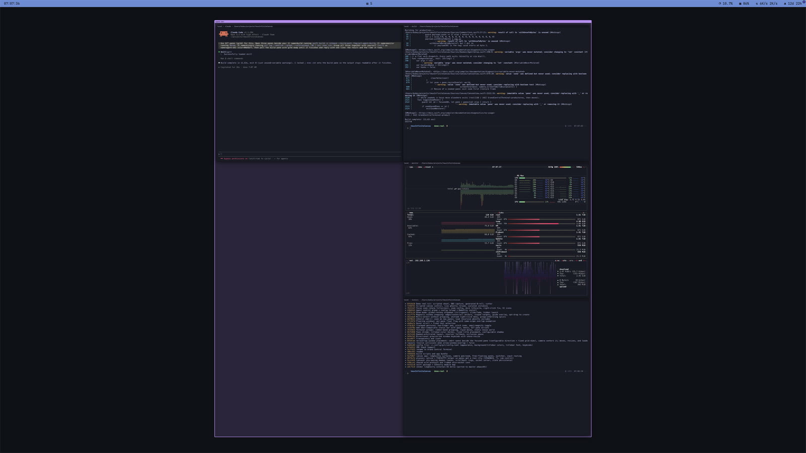

# Agents

`gctd` doubles as the CLI for agents and harnesses talking to the running
daemon. The point: a background job in a GCT pane is on your canvas, grouped,
with no time limit, and you can see what it's doing without asking. The agent
can still read it back. The full agent prompt is [SKILL.md](../SKILL.md).



## CLI

```sh
gctd open name=build cmd="make -j8"   # pane around the working one, prints id
gctd open name=log size=900,640 cmd="tail -f x.log"   # sized for the job
gctd list                             # panes + groups
gctd dump $ID limit=4000 --strip-ansi # scrollback tail as readable text
gctd send $ID "make test"             # type into the pane (+ newline)
gctd send $ID --no-newline '\x03'     # \xHH, \e, \n, \t, \r escapes: ^C is \x03
gctd dump $A --strip-ansi | gctd send $B --paste   # no text reads stdin
gctd notify $ID "build failed"        # desktop notification; click focuses the pane
gctd rename $ID name=server
gctd group $A $B name=feat color=#3b82f6   # or palette:N; omit for auto
gctd focus $ID                        # focus + center on the canvas
gctd camera $ID zoom=0.4 dur=3        # glide to a pane (or x= y=) at a zoom
gctd do fit-all [$ID] [dur=4]         # run any keybind action, focusing $ID first
gctd close $ID
```

`send --paste` wraps the text in bracketed paste, so a multi-line payload lands
as one paste instead of running line by line (the program must have asked for
it: shells and editors do). `notify` takes `title=..`; it shows nothing for a
pane you're already looking at.

Panes are addressed by uuid prefix, exact name, or `self` (the calling pane's
`$GCT_PANE_ID`). `dump` reads the daemon's 8 MiB VT ring read-only, so poll it
to follow a task; `--strip-ansi` scrubs escapes. `cmd=` runs through the login
shell (real syntax: `&&`, pipes, quotes) and the pane exits when the command
does (`; exec zsh` keeps it open). `size=w,h` (world points) resizes the new
pane but keeps it around the caller: `480,240` for builds and servers,
`900,640` for log tails.

Group correlated windows, tail subagents in small grouped panes, close task
panes when the work lands.

## How an agent finds out

```sh
gctd agent-setup install --hooks --yes   # skill into every harness dir + Claude hook
gctd agent-setup print                   # targets + skill text (manual installs)
gctd agent-setup context                 # live pane state (what the hook emits)
```

`install --hooks` also merges Claude `Notification` and `Stop` hooks that call
`gctd notify self --hook`, so a Claude Code session in a pane pings you when it
needs input or finishes. The hook exits 0 outside a GCT pane and never blocks
the agent.

`install` copies `SKILL.md` (staged beside the daemon by `make build`, no
network) into the Claude, Codex, opencode, Cursor, and Cursor-agents skill
dirs (`--harness=` narrows it; dry-run without `--yes`). `--hooks` merges a
Claude `SessionStart` hook (via `/usr/local/bin/gctd`, no spaces) that injects
live pane state every session. That's the discovery path: the agent learns GCT
exists, and what's on the canvas, before the first prompt.

The hook has a 15s timeout and `|| exit 0`. Daemon down, wedged, or an
unexecable binary means empty context, never an error, never a blocked start.
Re-running `install --hooks` migrates stale entries in place. Codex also needs
`[features] skills=true` in its config.

The app's "Install gctd Command…" menu item does the same thing plus the
`/usr/local/bin/gctd` symlink.

## Program status

Anything that speaks [OSC 7501](https://www.superlogical.com/rex/docs/build/program-status)
gets its state in the pane's titlebar (`◌ 40%` working, `▲` blocked, `✓` done,
`✕` error). See
`demo/bin/osc7501-demo.sh` for a sender.
