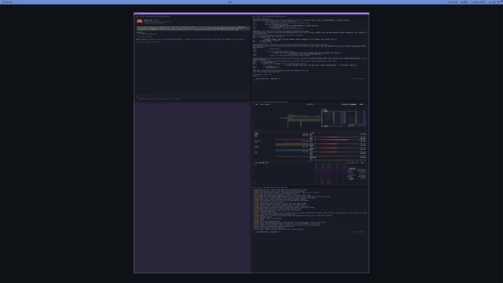

# Agents

`gctd` doubles as the CLI for agents and harnesses talking to the running
daemon. The point: a background job in a GCT pane is on your canvas, grouped,
with no time limit, and you can see what it's doing without asking. The agent
can still read it back. The full agent guide is `gctd agent show`.



## CLI

```sh
gctd open name=build size=640,360 cmd="make -j8"   # pane around the working one, prints id
gctd open name=log size=900,640 cmd="tail -f x.log"   # sized for the job
gctd list [--json]                    # panes + groups; --json is the stable form
gctd inspect [$ID] [--json]           # one pane in full (default: the caller)
gctd hosts                            # peers this daemon dials, up or down
gctd open --wait size=640,360 cmd="make test"      # block, exit with the command's status
gctd wait $ID                         # same, for a pane already running
gctd dump $ID limit=4000 --strip-ansi # scrollback tail as readable text
gctd send $ID "make test"             # type into the pane (+ newline)
gctd send $ID --no-newline '\x03'     # \xHH, \e, \n, \t, \r escapes: ^C is \x03
gctd dump $A --strip-ansi | gctd send $B --paste   # no text reads stdin
gctd notify $ID "build failed"        # desktop notification; click focuses the pane
gctd open parent=$ID name=tests size=50%,100%     # wired (cable) to $ID, whoever calls
gctd tie $ID $A $B at=0.4             # bundle the cables from $ID to $A, $B
gctd untie $TIE                       # tie ids are in `gctd list`
gctd move $ID rect=x,y,w,h            # place a pane (overlap rules still apply)
gctd rename $ID name=server
gctd group $A $B name=feat color=#3b82f6   # or palette:N; omit for auto
gctd ungroup $GROUP                   # dissolve a group (panes survive)
gctd focus $ID                        # focus + center on the canvas
gctd camera $ID zoom=0.4 dur=3        # glide to a pane (or x= y=) at a zoom
gctd do fit-all [$ID] [dur=4]         # run any keybind action, focusing $ID first
gctd close $ID
```

`send --paste` wraps the text in bracketed paste, so a multi-line payload lands
as one paste instead of running line by line (the program must have asked for
it: shells and editors do). `notify` takes `title=..`; it shows nothing for a
pane you're already looking at.

Panes are addressed by uuid (or `pane:<uuid>`), a unique id prefix or suffix
(4+ characters), exact name, or `self` (the calling pane's `$GCT_PANE_ID`). A
name or prefix that matches several panes changes nothing: the candidates are
listed and the exit status is 3. `dump` reads the daemon's 8 MiB VT ring read-only, so poll it
to follow a task; `--strip-ansi` scrubs escapes. `cmd=` runs through the login
shell (real syntax: `&&`, pipes, quotes) and the pane exits when the command
does (`; exec zsh` keeps it open). `size=w,h` (world points) resizes the new
pane but keeps it around the caller: `480,240` for builds and servers,
`900,640` for log tails.

### Scripting

`--json` prints one line with full ids and fixed keys; parse it, not the table:

```sh
gctd list --json | jq -r '.panes[] | select(.exited | not) | .name'
gctd open --wait name=t size=640,360 cmd="pytest -q" || echo "tests failed: $?"
```

`wait` and `open --wait` leave with the program's own status (`n` for
`exit(n)`, `128+signal` when killed). A pane closed by a client has no status
and gives 1. The last 256 ended panes still answer `wait`; older ones are 3.

| status | meaning |
| --- | --- |
| 0 | ok |
| 1 | failed |
| 2 | invalid command line |
| 3 | pane/group/tie not found or ambiguous |
| 4 | daemon unreachable |

Inside a pane, `GCT_BIN_DIR` is the directory of the `gctd` that matches the
running daemon, and it starts first on `PATH`. Your shell's startup files run
after that: one that sets `PATH` to a fixed list (or macOS `path_helper`
hoisting `/usr/local/bin`) can put an older `gctd` ahead of it. Pin it in
`~/.zshrc` / `~/.bashrc`:

```sh
if [ -n "$GCT_BIN_DIR" ]; then
    export PATH="$GCT_BIN_DIR:$PATH"
fi
```

`gctd help` lists every command; `gctd help <command>` has the details.

Group correlated windows, tail subagents in small grouped panes, close task
panes when the work lands.

## How an agent finds out

```sh
gctd agent setup     # skill + hooks for every agent found; safe to rerun
gctd agent status    # current / outdated / missing / foreign per item
gctd agent remove    # take both back out
```

Two things get installed:

- **The skill** is a stub. It tells the agent to run `gctd agent show`, which
  prints the guide from the installed `gctd`. Upgrading gctd updates what
  agents know; nothing to reinstall.
- **The hooks.** `SessionStart` runs `gctd agent context`, one line saying
  which pane the agent is in, so it doesn't spend a call finding out. Claude
  Code also gets `Notification` and `Stop` hooks (`gctd notify self --hook`)
  that ping you when a session needs input or finishes.

| Agent | `--agent` | Skill | Hooks |
|---|---|---|---|
| Claude Code | `claude` | `~/.claude/skills/gct` | `~/.claude/settings.json` |
| Codex | `codex` | `~/.agents/skills/gct` | `~/.codex/hooks.json` (`SessionStart`) |
| opencode | `opencode` | `~/.agents/skills/gct` | none |
| pi | `pi` | `~/.agents/skills/gct` | none |

Agents are found by config dir (`CLAUDE_CONFIG_DIR` and `CODEX_HOME` are
honored) or by program on `PATH`. `--agent NAME` sets one up whether or not it
was found. `--project` targets the current repository instead of your
account, `--dry-run` reports without changing anything, `--force` replaces a
`gct` skill gctd didn't install, `--json` prints the result.

Setup merges into the settings file and keeps every other key and hook (the
file is rewritten with sorted keys). A file that isn't valid JSON is left
alone and reported `failed`. Rerunning reports current items as `unchanged`
and migrates older entries in place. Every hook ends in `|| exit 0` and has a
timeout: daemon down, wedged, or an unexecable binary means no context, never
an error, never a blocked start. The hook prints nothing outside a GCT pane.

Hooks only run in sessions that start after setup. Codex asks you to approve a
new or changed hook with `/hooks`; Claude Code skips hooks until you trust the
folder. Any other agent that can run commands in a pane can still run
`gctd agent show` and follow the guide.

The guide tells agents how to pick a target: "here" and "beside you" mean
their own pane, a name beats everything, and "the focused pane" gets a
question back, because the daemon can't see canvas focus.

The app's "Install gctd Command…" menu item does the same thing plus the
`/usr/local/bin/gctd` symlink.

## Program status

Anything that speaks [OSC 7501](https://www.superlogical.com/rex/docs/build/program-status)
gets its state in the pane's titlebar (`◌ 40%` working, `▲` blocked, `✓` done,
`✕` error). See
`demo/bin/osc7501-demo.sh` for a sender.
