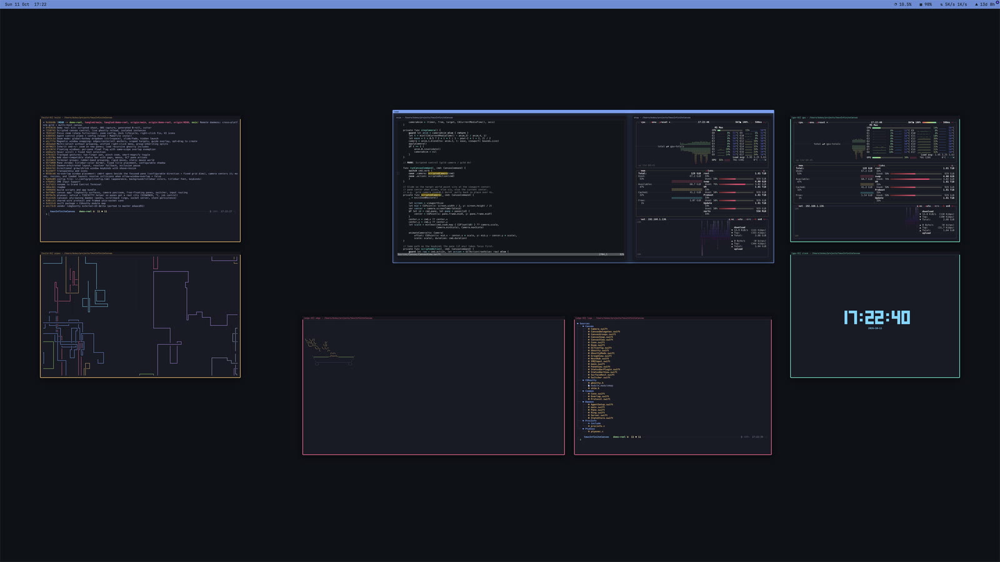

# Remote daemons

`gctd` runs on macOS (unix socket, `.app`-bundled) and Linux (unix socket plus
optional TCP). Every machine has one session: its own canvas. You can create
panes on other machines from yours, and you can attach to their sessions.



## Install the daemon

Grab `gctd-<ver>-linux-<arch>.tar.gz` from the releases page (static, runs on
any distro), or build and deploy over ssh. Swift builds in a container on the
remote, so you only need ssh and podman there. This installs a systemd user
service (linger on, restart on failure).

```sh
scripts/build-remote.sh user@host 7420 <token>
scripts/install-remote.sh user@host 7420 <token>

# or by hand
gctd --port=7420 --token=<token>
```

## Point the canvas at it

```toml
# ~/.config/gct/config.toml
[host.enterprise]
host = "192.168.1.38"
port = 7420
token = "<token>"
color = "#f59e0b"   # optional; default = hashed onto your ghostty palette
# color-dark / color-light override per mode; "palette:N" works too
```

`⌘⇧R` reloads config; the canvas connects and the host's panes join.

Can't reach the port? Tunnel it (the token never leaves localhost):

```sh
ssh -L 7420:127.0.0.1:7420 -N -f user@host
```

```toml
[host.enterprise]
host = "127.0.0.1"
port = 7420
token = "<token>"
```

Behind a bastion? Set `proxy` and the canvas runs `ssh -W host:port proxy` for
you (key/agent auth only, no prompts; `host` is as the bastion sees it):

```toml
[host.enterprise]
host = "10.0.0.5"
token = "<token>"
proxy = "user@bastion"   # or an ~/.ssh/config alias
```

## Sessions

```
canvas ─► local gctd ─ your session ─┬─ local pty
                                     └─ proxy ──tcp──► enterprise gctd (guest pty)
```

- **Your session** is the local canvas. Right-click empty canvas → "New remote
  pane" → host runs the pty on that machine, but the pane sits in *your*
  layout: it groups, ties and arranges like any other, and wears the host's
  color. `gctd open host=enterprise size=640,360` does the same from the CLI.
- **Their session** is what's on that machine's own canvas. Right-click →
  "Session" attaches the host (nothing attaches on its own, and a relaunch
  starts local-only) and shows it; `⌘⇧E` cycles the attached ones. The sets of
  panes are independent, and each session remembers its camera.
- **Attached sessions stay live.** One is on screen, the rest are parked:
  hidden, not rendering, but still running, so a bell, OSC 9 or agent hook in
  a parked session posts a banner naming its host, and clicking it switches
  there. The Session menu lists every configured host (attached,
  reconnecting, not attached) with unread counts and a Detach row; the window
  title shows how many sessions are attached. `gctd font` and `gctd session`
  from any attached daemon reach the canvas; `gctd camera` and `gctd do` act
  only on the session on screen.
- Your daemon dials every `[host.*]` itself and re-reads `config.toml` when it
  changes, so `⌘⇧R` reaches it too.

## Rules

- Remote panes are PTYs on the remote; scrollback, resize, groups and
  persistence work. Your daemon keeps its own copy of the scrollback.
- `⌘T` and directional splits follow the focused pane's host.
- A host that drops greys its panes (`○`) and keeps them in the layout. Your
  daemon redials with backoff (2s up to 60s); a greyed row under "New remote
  pane" has a retry button. When it's back, panes reattach; if the remote
  restarted, they come back as fresh shells in the same spot.
- Guests belong to the daemon that made them. If you lose the pane for one
  (crash, closed while the host was down) the host reaps it at the next
  reconnect; one whose owner never returns goes after 7 days. `gctd list` on
  the host shows them as `guest-of=`; `gctd close <id>` kills one.
- Attaching to a host's session needs only the canvas to reach it, but "New
  remote pane" needs *your daemon* to. Behind a bastion, `proxy` is used by
  both.
- On macOS the daemon runs inside its own background app, `GCT Daemon.app` (in
  the canvas bundle, no Dock icon). macOS ties a process's LAN access to the app
  that started it, so a daemon started by the canvas lost its peer links the
  moment the canvas quit. As its own app it keeps them across canvas restarts.
  If macOS asks to let "GCT Daemon" find devices on your local network, allow it;
  peers stay down until you do. The daemon's log is `daemon.log` next to
  `state.json`.
- Agents in a remote pane talk to that machine's gctd: `gctd open` there lands
  in its own session, not yours.
- Switching sessions closes the old connection, so panes of a session you
  aren't looking at can't ping you.

## CLI against a remote

```sh
gctd --tcp=192.168.1.38:7420 --token=<token> list   # env: GCT_TCP, GCT_TOKEN
gctd --port=7420 --token=<token>                    # serve; env: GCT_PORT, GCT_TOKEN
```

Paths honor `$HOME` first; `GCT_HOME` overrides the base dir (Linux default
`~/.config/gct`).
